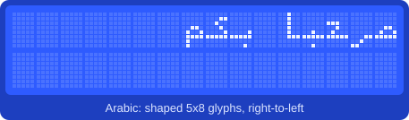
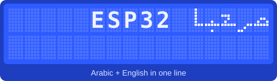
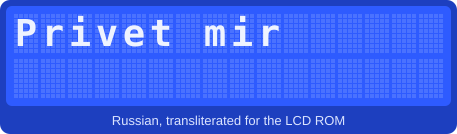
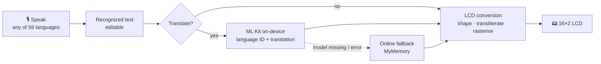
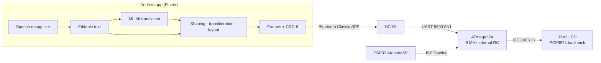

<div align="center">

# 🎙️ Speech-to-Text Bluetooth Display

**Speak in any language, see it on a 16×2 LCD.**
An Android app recognises (and optionally translates) your speech and sends it over Bluetooth to an **ATmega32A**, which renders it on an HD44780 LCD, including **Arabic drawn with hand-made 5×8 glyphs**.

[](https://github.com/mo321ag-stack/speech-to-text-bluetooth-display/actions/workflows/ci.yml)
[](https://github.com/mo321ag-stack/speech-to-text-bluetooth-display/releases/latest)
[](LICENSE)



<br/>

<br/>


<sub>These images are generated from the app's real layout and font code (<code>test/render_svg_test.dart</code>), pixel for pixel what the LCD shows.</sub>

</div>

---

## ✨ Features

| | |
|---|---|
| 🗣️ **Speech recognition** | 59 languages, plus a **Mix** mode for Arabic + English in the same sentence (Android 14+, on-device) |
| 🌍 **Translation** | Translate to any of 59 languages **on the phone** with Google ML Kit (offline after a one-time model download), with an online fallback |
| 🔤 **Arabic on a character LCD** | Contextual shaping (isolated / initial / medial / final, لا ligature), right-to-left layout, Persian & Urdu letters, hand-drawn 5×8 font loaded into CGRAM |
| 🔡 **Other scripts** | Latin accents folded to ASCII, Cyrillic & Greek transliterated, other scripts rasterised automatically |
| 📡 **Robust link** | Framed protocol `AA 55 · type · len · payload · CRC-8` with ACK/NAK, timeouts and overflow counters |
| 📱 **Live preview** | The app shows exactly what the LCD will display, page by page |
| 🧰 **Rescue programmer** | ESP32 ArduinoISP sketch with a clock output that revives an AVR whose fuses point to a dead crystal |

## 🌍 Languages & translation

### How it works



1. **Speech language:** choose from the 59 languages, or **Mix (Arabic + English)**. Mix uses Android 14+ language switching, with on-device recognition.
2. **Translate before sending** (optional): the source language is detected automatically with ML Kit Language ID, and you pick any target language.
   - **On-device (default):** Google ML Kit Translation. Each language model is downloaded once (about 30 MB), then translation works **offline**, with no API key.
   - **Online fallback:** if the on-device path fails (no Google Play services, model download blocked), the app uses the MyMemory API. The text is sent over the internet in that case, and the app says so.
   - The translated text stays editable before sending.
3. **LCD conversion:** each language is shown in the best way the HD44780 allows:

| LCD rendering | Quality | Languages |
|---|---|---|
| **Native ASCII** (accents removed: é→e, ß→ss) | ✅ Perfect, no page limit | English (English), French (Français), Spanish (Español), German (Deutsch), Italian (Italiano), Portuguese (Português), Turkish (Türkçe), Dutch (Nederlands), Swedish (Svenska), Norwegian (Norsk), Danish (Dansk), Finnish (Suomi), Polish (Polski), Czech (Čeština), Slovak (Slovenčina), Romanian (Română), Hungarian (Magyar), Croatian (Hrvatski), Slovenian (Slovenščina), Lithuanian (Lietuvių), Latvian (Latviešu), Estonian (Eesti), Indonesian (Bahasa Indonesia), Malay (Bahasa Melayu), Vietnamese (Tiếng Việt), Filipino (Filipino), Swahili (Kiswahili), Afrikaans (Afrikaans), Albanian (Shqip), Catalan (Català), Galician (Galego), Irish (Gaeilge), Welsh (Cymraeg), Icelandic (Íslenska), Maltese (Malti), Esperanto (Esperanto), Haitian Creole (Kreyòl) |
| **Transliterated to Latin** (Привет→Privet, Γειά→Geia) | ✅ Readable, no page limit | Russian (Русский), Ukrainian (Українська), Greek (Ελληνικά), Bulgarian (Български), Belarusian (Беларуская), Macedonian (Македонски) |
| **Custom glyphs** (shaped, right-to-left) | 🟡 Good, max 8 different letter shapes per screen | Arabic (العربية), Persian (فارسی), Urdu (اردو) |
| **Auto-rasterised** into 5×8 px | 🟠 Limited legibility | Chinese (中文), Japanese (日本語), Korean (한국어), Hindi (हिन्दी), Hebrew (עברית), Bengali (বাংলা), Tamil (தமிழ்), Telugu (తెలుగు), Marathi (मराठी), Gujarati (ગુજરાતી), Kannada (ಕನ್ನಡ), Thai (ไทย), Georgian (ქართული) |

The app's live preview shows which of these applies and exactly what the LCD will display.

## 🏗️ Architecture



**Why the phone does the Arabic work:** an HD44780 has no Arabic font and only **8 user-defined characters on screen at once**. The app shapes the text, orders it right to left, splits it into pages with at most 8 distinct glyphs each, and sends the glyph bitmaps with the cell codes. The ATmega stores up to 8 pages, loads each page's glyphs into CGRAM and cycles through them. English is sent as plain text, and the MCU word-wraps it itself. Details: [docs/PROTOCOL.md](docs/PROTOCOL.md).

## 📘 Technical report

A 44-page report covering background, design, firmware, protocol, app, tests and references: **[PDF](Speech_To_Text_Bluetooth_Display/Documentation/Technical_Report.pdf)** · [DOCX](Speech_To_Text_Bluetooth_Display/Documentation/Technical_Report.docx).

## 🔌 Hardware

| Part | Notes |
|---|---|
| ATmega32A (DIP-40) | Internal RC 8 MHz (`LFUSE=0xE4`, `HFUSE=0xD9`) |
| HC-05 | TXD → PD0 (pin 14); PD1 (pin 15) → 1 kΩ/2 kΩ divider → RXD |
| 16×2 LCD + PCF8574 | SDA → PC1 (pin 23), SCL → PC0 (pin 22); address auto-detected |
| ESP32 DevKit V1 | ISP programmer (only for flashing) |

Full wiring, fuses and the ISP recovery story: **[docs/HARDWARE.md](docs/HARDWARE.md)**.

## 🚀 Quick start

1. **Flash the firmware.** Download `bt_display_atmega32a.hex` from [Releases](https://github.com/mo321ag-stack/speech-to-text-bluetooth-display/releases/latest):
   ```bash
   avrdude -c stk500v1 -P COM4 -b 19200 -p m32 -U flash:w:bt_display_atmega32a.hex:i
   ```
2. **Install the app** (`SpeechBTDisplay-arm64.apk`), pair the HC-05 (PIN `1234`), and press **Connect**.
3. Pick a language, tap 🎙️, speak, optionally translate, then press **Send**.

> Quick test without the app: any Bluetooth serial terminal works. Send `#HELLO`, `#AR`, `#CLR`, `#INFO`, or plain text.

## 🛠️ Build from source

**Firmware** (avr-gcc):
```bash
cd Speech_To_Text_Bluetooth_Display/Firmware
make            # or build.bat on Windows (uses the Arduino IDE toolchain)
```

**App** (Flutter ≥ 3.50, Android SDK 36):
```bash
cd Speech_To_Text_Bluetooth_Display/Mobile_App/speech_bt_display
flutter test
flutter build apk --release --split-per-abi
```

> On Windows, the Android Gradle plugin rejects project paths with non-ASCII characters. If your path has any, build from a copy in an ASCII path.

## 📁 Repository layout

```
├── Speech_To_Text_Bluetooth_Display/
│   ├── Firmware/                 AVR C: main, uart, twi_i2c, lcd_i2c, protocol, arabic_display
│   └── Mobile_App/speech_bt_display/
│       ├── lib/lcd/              shaping, 5×8 font, transliteration, rasteriser, page layout
│       ├── lib/protocol/         frame builder + CRC-8
│       ├── lib/services/         Bluetooth SPP, speech recognizer, translator
│       ├── android/.../MainActivity.kt   native SPP + SpeechRecognizer
│       └── test/                 unit tests (shaping, layout, protocol)
├── ESP32_ArduinoISP_Clock/       ESP32 STK500v1 programmer with rescue clock
└── docs/                         hardware, protocol, images
```

## ⚠️ Known limitations

- A 16×2 HD44780 can show at most **8 different Arabic letter shapes per screen**, and its cell gaps prevent letters from visually joining. For fluent Arabic, a graphic display (e.g. 128×64 OLED) is the right hardware.
- Chinese, Japanese, Hindi and similar scripts are auto-rasterised into 5×8 pixels, so legibility is limited.
- The MCU → phone reply line (ACK/NAK) depends on the HC-05 RXD divider wiring. Sending works without it.

## 📄 License

[MIT](LICENSE)
